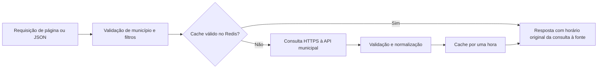

# Arquitetura

## Escopo implementado

Aplicação única em Next.js App Router, React e TypeScript. A tela inicial usa o mapa SVG com os 52 municípios do IBGE e a rota `/[municipio]`. Slugs desconhecidos recebem 404.

- Porto Velho: conector de Contratos implementado, com consulta direta e paginada à API oficial.
- Ji-Paraná: proposta de segunda integração; fontes ainda não levantadas.
- Demais municípios: cadastro geográfico, com integração não iniciada.
- Obras: catálogo completo sob demanda e cache por uma hora. Receitas: worker separado, atualização horária do exercício corrente e última versão válida retida por até sete dias. Veja [fontes e limites](obras-receitas-porto-velho.md).

Veja [fontes e interação do mapa municipal](mapa-municipal.md) e [Contratos de Porto Velho](contratos-porto-velho.md). O código do conector não comprova publicação ou disponibilidade de uma instalação de produção.

## Separação de responsabilidades

1. **Municípios**: identidade, slug e capacidades em `src/municipalities/`.
2. **Conectores**: entendimento e normalização de cada API em `src/connectors/`.
3. **Domínio**: schemas, parâmetros e controle da consulta em `src/core/`.
4. **Leitura no servidor**: `src/lib/`, protegida com `server-only`.
5. **Apresentação**: páginas e componentes, sem regras específicas de APIs.

O contrato público de Contratos preserva IDs, centavos, ausentes, datas e documentos, com minimização de CPF. O contrato inicial `MunicipalConnector` e a função `snapshotKey` permanecem preparações para uma futura coleta completa; não são o fluxo de consulta paginada atual.

## Fluxo de Contratos e Obras: cache e API municipal

- 25 registros por página, com filtro opcional de ano, e ficha individual pelo ID oficial.
- Porto Velho possui conectores de Obras, Contratos e Receitas. Obras lê o catálogo completo; Receitas consolida o exercício selecionado. Contratos permanece paginado.
- `connection()` exclui as consultas do build; `fetch` usa `cache: "no-store"`.
- Timeout, limite de tamanho da resposta e erros públicos sem conteúdo bruto.
- IDs únicos, modelo, contagens e metadados são conferidos antes de responder. O ano é um parâmetro solicitado à fonte: divergências no ano publicado geram avisos explícitos, preservando registros e totais oficiais.
- Falhas não geram catálogo vazio, zero estimado nem fallback silencioso.
- HTML e JSON compartilham o leitor e o cache. A API municipal é consultada quando a chave não existe, expirou ou não pôde ser lida. `fetchedAt` sempre indica a consulta original à fonte; hits não renovam a validade.
- Não há soma financeira de páginas parciais nem garantia de consistência global entre páginas consultadas em horários diferentes.

## Cache Redis e histórico

O cliente oficial `redis` consulta a instância Docker da VPS por TCP somente no servidor. Configure `REDIS_URL` e `REDIS_PASSWORD` conforme `.env.example`. Contratos e Obras podem consultar a API diretamente sem Redis. Receitas depende do Redis e do worker; sem versão, retorna estado pendente, sem coleta durante a requisição. Veja [Receitas em segundo plano](receitas-background.md).

Chaves: `observatorio:RO:porto-velho:contratos:v1:list:year:<ano|all>:page:<página>:size:25` e `observatorio:RO:porto-velho:contratos:v1:detail:<ID>`. Cada entrada contém somente o resultado normalizado, horário original e expiração, com `EX 3600`. O schema e a identidade da consulta são validados ao ler. Erros, 404, respostas inválidas e entradas expiradas não são reutilizados. Redis tem timeout de 1,5 segundo por operação completa, sem fila offline ou reconexão automática em loop; a API conserva seu timeout de 12 segundos.

Requisições simultâneas de uma mesma chave compartilham a leitura em andamento dentro do processo. Contratos e Obras não têm lock distribuído. Receitas usa lease por exercício, fila com agendamento e publicação atômica com verificação do proprietário. O limite de consultas à Prefeitura é compartilhado via Redis pelo site e pelo worker. O JSON inclui `cache.status` (`hit`, `miss`, `disabled` ou `unavailable`) e `cache.expiresAt`; o cabeçalho `X-Observatorio-Cache` repete o estado. `Cache-Control: no-store` impede cache HTTP adicional. Não há garantia de uma revisão global coerente entre páginas.

Veja [operação do Redis na VPS](redis.md) para rede Docker, porta externa e túnel SSH.

Uma eventual coleta completa deverá validar a cobertura antes de publicar uma revisão. Falhas devem preservar a última revisão válida, e uma execução antiga não pode sobrescrever uma revisão nova. Cache temporário e retenção histórica precisam ter políticas distintas.

A proposta anterior de API → coleta completa → arquivo durável → Redis continua uma possibilidade futura, sem implementação. Não há PostgreSQL, histórico persistido ou migração do banco do Observatório de Porto Velho neste repositório.

## Operação e publicação

O CI usa um workflow reutilizável com Node.js 22, fixtures sintéticas e Redis isolado, sem consultar a Prefeitura. Cada execução constrói uma imagem Docker, testada com aplicação e worker. PRs não publicam imagens nem recebem segredos de produção; o CI da master publica a imagem aprovada no GHCR e seu manifesto de digest. O workflow de produção seleciona esse manifesto de um CI aprovado do mesmo commit, sem reconstrução, antes do SSH restrito e da verificação de saúde. A instalação na VPS e o DNS estão configurados; a publicação inicial e o cache dos três módulos de Porto Velho foram verificados em 19/10/2026. O worker de Receitas mantém o agendamento no Redis; não há cron externo de coleta. Veja [produção e credenciais](producao.md).

O runtime das rotas de dados é Node.js. Hospedagem futura em Workers exige validação específica. O endereço de produção é `rondonia.dadosabertos.org`, com uma aplicação e paths por município.

## Documentação consultada

- Guias da versão instalada em `node_modules/next/dist/docs/`.
- [API pública da Prefeitura de Porto Velho](https://api.portovelho.ro.gov.br/docs/api).
- [SDK Redis em Docker na VPS](https://upstash.com/docs/redis/sdks/ts/overview).
- [connection no Next.js](https://nextjs.org/docs/app/api-reference/functions/connection).
