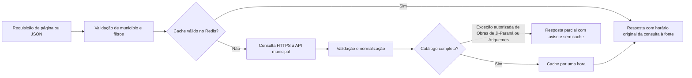

# Arquitetura

## Escopo implementado

Aplicação única em Next.js App Router, React e TypeScript. A tela inicial usa o mapa SVG com os 52 municípios do IBGE e a rota `/[municipio]`. Slugs desconhecidos recebem 404.

- Porto Velho: conectores de Contratos, Obras e Receitas implementados, com consulta à API oficial.
- Ji-Paraná: segunda integração implementada localmente para Contratos, Obras e Receitas da Prefeitura, unidade gestora 2. Os módulos preservam os conceitos da API Pública; Receitas tem cobertura parcial de três grupos anuais, sem soma global ou série mensal.
- Ariquemes: terceira integração implementada localmente, com Contratos, Obras e Receitas da Prefeitura, unidade gestora 1. Usa os algoritmos da plataforma Pública com configuração municipal própria, sem reutilizar a UG de Ji-Paraná.
- Demais municípios: cadastro geográfico, com integração não iniciada.
- Obras: catálogo completo do endpoint consultado, sob demanda e com cache por uma hora. Ji-Paraná e Ariquemes exigem exercício, incluído na chave do cache. Há duas exceções explicitamente autorizadas para consulta parcial, com aviso e sem cache: Ji-Paraná admite a falta exata de uma linha na última página; Ariquemes admite contagem recebida menor que a declarada após consultar todas as páginas com metadados válidos e estáveis e normalizar todos os registros, agrupando somente repetições equivalentes do mesmo ID. As demais falhas de paginação continuam bloqueadas. Receitas: worker separado, atualização horária do exercício corrente e última versão válida retida por até sete dias. Veja [fontes e limites de Porto Velho](obras-receitas-porto-velho.md), [Ji-Paraná](ji-parana.md) e [Ariquemes](ariquemes.md).

Veja [fontes e interação do mapa municipal](mapa-municipal.md) e [Contratos de Porto Velho](contratos-porto-velho.md). A implementação local de uma integração não comprova publicação ou disponibilidade em produção: é necessário conferir CI, deploy e a instalação pública. O cadastro tem três pilotos implementados e 49 municípios com integração não iniciada.

## Separação de responsabilidades

1. **Municípios**: identidade, slug e capacidades em `src/municipalities/`.
2. **Conectores**: entendimento e normalização de cada API em `src/connectors/`.
3. **Domínio**: schemas, parâmetros e controle da consulta em `src/core/`.
4. **Leitura no servidor**: `src/lib/`, protegida com `server-only`.
5. **Apresentação**: páginas e componentes, sem regras específicas de APIs.

O contrato público de Contratos preserva IDs, centavos, ausentes, datas e documentos, com minimização de CPF. O contrato inicial `MunicipalConnector` e a função `snapshotKey` permanecem preparações para uma futura coleta completa; não são o fluxo de consulta paginada atual.

Os conectores Pública compartilham algoritmos em `src/connectors/publica/`; os wrappers em `ji-parana/` e `ariquemes/` preservam suas interfaces. `publicaSource` define host e UG por município, e `publicaTransport` mantém transporte e limitador separados. Compartilhar a plataforma não torna as unidades gestoras intercambiáveis: Ji-Paraná usa 2, Ariquemes usa 1.

## Fluxo de Contratos e Obras: cache e API municipal

- Contratos: 25 registros por página na apresentação. Porto Velho oferece esse tamanho diretamente; Ji-Paraná e Ariquemes publicam páginas de 10, que o conector reorganiza após conferir os metadados e a cobertura necessária. Busca, filtros locais e ordenação não consultam o restante do catálogo.
- Ji-Paraná e Ariquemes exigem exercício em todos os módulos; o padrão é o ano corrente no fuso de Rondônia. A consulta se limita à Prefeitura, sem incluir a Câmara. Seus IDs de Contratos e Obras carregam o exercício e preservam o identificador da origem em campo separado.
- Obras da Pública lê todas as páginas daquele exercício antes de declarar o catálogo completo, com limite de 2.000 registros e 200 páginas. Isso não comprova cobertura de todas as obras municipais. O valor total informado é separado de contratado, pago e a medir; o percentual publicado não é cálculo de execução física do Observatório.
- Por decisão explícita do mantenedor, Obras de Ji-Paraná permite uma exceção de cobertura: se apenas a última página tiver exatamente uma linha a menos, todos os registros recebidos forem válidos e as repetições do mesmo ID forem equivalentes após a normalização, responde com `complete: false` e `coverage` (`reportedRows`, `receivedRows`, `repeatedRows`, `assumedMissingRows: 1`). `total` conta somente obras únicas recebidas. HTML, fichas e JSON mantêm a cobertura parcial explícita; o registro ausente não é inventado. Um ID não recebido nesse recorte não vira 404. Outras inconsistências, inclusive repetições conflitantes, continuam bloqueadas. Essa exceção unitária não se aplica a Ariquemes, Contratos ou Receitas.
- Obras de Ariquemes possui uma exceção própria, também autorizada: após consultar todas as páginas declaradas com metadados válidos e estáveis, pode responder com os registros normalizados quando a quantidade recebida é menor que o total declarado. Agrupa somente repetições do mesmo ID com todos os campos públicos normalizados equivalentes, preservando IDs únicos na apresentação. Usa `complete: false`, `total` igual às obras únicas recebidas e `coverage` (`reportedRows`, `receivedRows`, `repeatedRows`, `rowDifference`). HTML e fichas exibem **“Dados inconsistentes na fonte”** e o JSON preserva a diferença entre linhas declaradas e recebidas e o número de repetições agrupadas. Não se presume se o contador está errado ou quais registros foram omitidos. IDs não recebidos nesse recorte não viram 404. Falhas HTTP, metadados inválidos ou alterados, linhas excedentes, registros inválidos, repetições conflitantes e consulta sem registros para total positivo continuam bloqueados. Respostas completas mantêm a rejeição de IDs repetidos. A regra não se estende a Contratos, Receitas ou outros municípios.
- A ficha de Contratos da Pública depende da leitura completa do exercício, pois a API não oferece detalhe por código. Há limite de 5.000 registros e 500 páginas; erro, limite excedido ou cobertura alterada não viram registro inexistente.
- `connection()` exclui as consultas do build; `fetch` usa `cache: "no-store"`.
- Timeout, limite de tamanho da resposta e erros públicos sem conteúdo bruto.
- IDs únicos, identidade municipal, contagens e metadados são conferidos antes de responder. Porto Velho pode devolver ano divergente do filtro, preservado com aviso. Contratos e Obras da Pública distinguem o exercício da consulta do ano publicado no registro, preservando divergências com aviso; o critério interno do filtro da fonte não é presumido.
- Falhas não geram catálogo vazio, zero estimado nem fallback silencioso.
- HTML e JSON compartilham o leitor e o cache. A API municipal é consultada quando a chave não existe, expirou ou não pôde ser lida. `fetchedAt` sempre indica a consulta original à fonte; hits não renovam a validade.
- Não há soma financeira de páginas parciais nem garantia de consistência global entre páginas consultadas em horários diferentes.

## Cache Redis e histórico

O cliente oficial `redis` consulta a instância Docker da VPS por TCP somente no servidor. Configure `REDIS_URL` e `REDIS_PASSWORD` conforme `.env.example`. Contratos e Obras podem consultar a API diretamente sem Redis. Receitas dos três municípios depende do Redis e do worker; sem versão, retorna estado pendente, sem coleta durante a requisição. Veja [Receitas em segundo plano](receitas-background.md) e os limites anuais de [Ji-Paraná](ji-parana.md#receitas) e [Ariquemes](ariquemes.md#receitas).

Chaves: `observatorio:RO:porto-velho:contratos:v1:list:year:<ano|all>:page:<página>:size:25` e `observatorio:RO:porto-velho:contratos:v1:detail:<ID>`. Cada entrada contém somente o resultado normalizado, horário original e expiração, com `EX 3600`. O schema e a identidade da consulta são validados ao ler. Erros, 404, respostas inválidas e entradas expiradas não são reutilizados. Redis tem timeout de 1,5 segundo por operação completa, sem fila offline ou reconexão automática em loop; a API conserva seu timeout de 12 segundos.

Cada município tem namespace próprio. Contratos da Pública usa `observatorio:RO:<município>:contratos:v1:...`; Obras usa `observatorio:RO:<município>:obras:v1:year:<ano>:catalog`, também com `EX 3600`. O catálogo de Obras mantém a URL oficial do exercício e a data original de consulta. Uma entrada de outro município, UG ou exercício não deve atender a consulta. As consultas parciais autorizadas de Ji-Paraná e Ariquemes não são gravadas nem reutilizadas no Redis e não substituem uma carga completa válida.

Requisições simultâneas de uma mesma chave compartilham a leitura em andamento dentro do processo. Contratos e Obras não têm lock distribuído. Receitas usa lease por município e exercício, fila com agendamento e publicação atômica com verificação do proprietário. O mesmo serviço Node `revenues-worker` atende os três municípios, uma coleta por vez, com namespaces independentes `observatorio:RO:<município>:receitas:v2`. O limite de consultas à fonte é compartilhado via Redis pelo site e pelo worker, isolado por município. O JSON de Contratos e Obras inclui `cache.status` (`hit`, `miss`, `disabled` ou `unavailable`) e `cache.expiresAt`; o cabeçalho `X-Observatorio-Cache` repete o estado. `Cache-Control: no-store` impede cache HTTP adicional. Não há garantia de uma revisão global coerente entre páginas.

Receitas de Ji-Paraná e Ariquemes valida todas as páginas dos três grupos implementados antes de publicar a versão. O contrato normalizado informa `aggregation: "annual-accounts"` e `coverage: "partial"`: valores anuais por rubrica não são documentos, meses ou total municipal. Não há soma global, percentual da previsão ou inferência de aditividade entre grupos. Essa cobertura difere da consolidação de documentos mensais de Porto Velho.

Veja [operação do Redis na VPS](redis.md) para rede Docker, porta externa e túnel SSH.

Uma eventual coleta completa deverá validar a cobertura antes de publicar uma revisão. Falhas devem preservar a última revisão válida, e uma execução antiga não pode sobrescrever uma revisão nova. Cache temporário e retenção histórica precisam ter políticas distintas.

A proposta anterior de API → coleta completa → arquivo durável → Redis continua uma possibilidade futura, sem implementação. Não há PostgreSQL, histórico persistido ou migração do banco do Observatório de Porto Velho neste repositório.

## Operação e publicação

O CI usa um workflow reutilizável com Node.js 22, fixtures sintéticas e Redis isolado, sem consultar a Prefeitura. Cada execução constrói uma imagem Docker, testada com aplicação e worker. PRs não publicam imagens nem recebem segredos de produção; o CI da master publica a imagem aprovada no GHCR e seu manifesto de digest. O workflow de produção seleciona esse manifesto de um CI aprovado do mesmo commit, sem reconstrução, antes do SSH restrito e da verificação de saúde. A instalação na VPS e o DNS estão configurados; a publicação inicial e o cache dos três módulos de Porto Velho foram verificados em 19/10/2026. O worker de Receitas mantém o agendamento no Redis; não há cron externo de coleta. Veja [produção e credenciais](producao.md).

O runtime das rotas de dados é Node.js. Hospedagem futura em Workers exige validação específica. O endereço de produção é `rondonia.dadosabertos.org`, com uma aplicação e paths por município.

## Documentação consultada

- Guias da versão instalada em `node_modules/next/dist/docs/`.
- [API pública da Prefeitura de Porto Velho](https://api.portovelho.ro.gov.br/docs/api).
- [Documentação da API Pública de Ji-Paraná](https://transparencia.ji-parana.ro.gov.br/api/doc) e [OpenAPI](https://transparencia.ji-parana.ro.gov.br/docs?api-docs.json).
- [Documentação da API Pública de Ariquemes](https://transparencia.ariquemes.ro.gov.br/api/doc).
- [SDK Redis em Docker na VPS](https://upstash.com/docs/redis/sdks/ts/overview).
- [connection no Next.js](https://nextjs.org/docs/app/api-reference/functions/connection).
