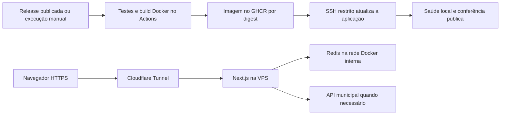

# Produção na VPS

Infraestrutura instalada em [rondonia.dadosabertos.org](https://rondonia.dadosabertos.org): VPS Hostinger, Docker Compose, Redis privado e Cloudflare Tunnel. A primeira publicação foi verificada em 19/10/2026, com HTTPS, redirecionamento HTTP, saúde da aplicação e consultas dos três módulos de Porto Velho. Consulte o Actions e `/api/health` para a revisão em execução.

## Fluxo



O Compose de produção está em `deploy/docker-compose.production.yml`; o Compose da raiz continua destinado ao desenvolvimento local. O projeto de produção chama-se `observatorio-rondonia` e não reutiliza Redis ou PostgreSQL de outros projetos da VPS. Nenhum serviço deste Compose publica portas no host. O Tunnel inicia conexões de saída para a Cloudflare; o DNS aponta para o Tunnel, sem registro A expondo a origem.

Redis guarda dados normalizados: cache de uma hora para Obras/Contratos e a última versão de Receitas por até sete dias, com renovação independente. O limite é de 128 MiB e a expulsão é `allkeys-lru`; a pressão de memória pode remover entradas antes do prazo. O volume e o snapshot Redis permitem reaproveitar entradas após reinício, sem constituir arquivo histórico ou backup dos dados públicos. A aplicação pode consultar a prefeitura se o Redis falhar. A API municipal pode ficar indisponível ou demorar em consultas completas.

## GitHub: environment `production`

Em **Settings → Environments → production**, restrinja o deploy à branch `master` e às tags de release `v*`. A chave desse environment nunca é disponibilizada a pull requests. Mudanças no workflow devem ser revisadas como código de produção.

| Tipo     | Nome              | Conteúdo                                                 |
| -------- | ----------------- | -------------------------------------------------------- |
| Secret   | `DEPLOY_SSH_KEY`  | Chave privada exclusiva do usuário `observatorio-deploy` |
| Variable | `VPS_HOST`        | IP ou domínio da VPS                                     |
| Variable | `VPS_PORT`        | Porta SSH, normalmente `22`                              |
| Variable | `VPS_USER`        | `observatorio-deploy`                                    |
| Variable | `SSH_KNOWN_HOSTS` | Chave pública do servidor previamente conferida          |

`GITHUB_TOKEN` é criado automaticamente por job: o build recebe `packages: write`; o deploy recebe `packages: read`. O token de leitura passa pelo stdin do SSH e faz login no GHCR em um diretório temporário `/run`, apagado ao sair. Não há PAT permanente na VPS nem necessidade de tornar o pacote público. A senha Redis e o token do Tunnel não são GitHub Secrets e não participam do build.

## VPS: instalação inicial

Use uma sessão administrativa previamente autorizada, Docker com Compose v2, `sudo` e `flock`. Confira os arquivos desta pasta antes de executar. Não substitua projetos existentes nem altere suas portas como efeito colateral.

1. Gere uma chave Ed25519 exclusiva para o Actions. Cadastre a parte privada no environment; leve somente a pública à VPS.
2. Copie a pasta `deploy/` para um diretório administrativo temporário e execute, como root:

   ```sh
   bash deploy/install.sh /caminho/deploy.pub cloudflare/cloudflared:AAAA.M.N
   ```

   Escolha uma versão existente e conferida do `cloudflared`. O instalador cria `/opt/observatorio-rondonia`, uma senha Redis aleatória e a conta restrita. Não coloque o diretório de produção dentro de um checkout público.

3. Crie um Tunnel gerenciado pela Cloudflare, exclusivo deste projeto. Configure a regra `rondonia.dadosabertos.org → http://app:3000` e uma última regra `http_status:404`. Grave o token somente em `/opt/observatorio-rondonia/secrets/tunnel-token`. O diretório `secrets/` deve pertencer a root com modo `700`; o arquivo pode ser `444` para leitura pelo usuário do container, protegido no host pelo diretório privado. Não use argumentos de shell, logs ou commits para transportar o token.
4. Configure o DNS CNAME proxied `rondonia.dadosabertos.org → <ID-do-tunnel>.cfargotunnel.com`, após conferir que o hostname está livre e que o Tunnel pertence à conta correta. O HTTPS público é fornecido pela Cloudflare.
5. Execute o workflow manual em `master`. O script inicia o Tunnel depois de conferir a saúde da aplicação. Para iniciá-lo manualmente durante uma recuperação, use como root:

   ```sh
   cd /opt/observatorio-rondonia
   APP_IMAGE="$(cat current-image)" docker compose --env-file runtime.env -f docker-compose.production.yml --profile public up -d cloudflared
   ```

   A verificação pública depende de o DNS apontar para esse Tunnel. Nas próximas atualizações, containers do Tunnel e do Redis cuja configuração não mudou continuam em execução.

6. Confira HTTPS, `/api/health`, navegação e as consultas reais dos módulos. Revogue qualquer chave administrativa temporária usada na instalação, preservando as chaves anteriores do mantenedor.

O usuário `observatorio-deploy` não pertence aos grupos Docker ou sudo. Sua chave possui `restrict` e comando forçado, sem terminal, encaminhamento ou shell livre. Ele só pode pedir `deploy sha256:<64 hex> <commit de 40 hex>`; o script root aceita exclusivamente imagens deste repositório e confere a revisão no rótulo da imagem. Compose, scripts, diretório e credenciais pertencem a root. Atualizações desses arquivos de infraestrutura exigem uma sessão administrativa; o Actions só troca a imagem.

## Releases, atualização e rollback

`.github/workflows/deploy.yml` executa em release estável publicada ou por acionamento manual, com tag/commit já presente em `master`. Push comum continua executando somente o CI. O workflow valida formato, testes, TypeScript, limites do comando SSH, constrói a imagem e testa `/api/health` no container Linux antes de publicar no GHCR.

O deploy usa o digest imutável e confere a revisão do processo. Se a saúde local falhar, restaura a última imagem saudável; no primeiro deploy, sem imagem anterior, interrompe a aplicação. O arquivo `current-image` só muda após sucesso. O deploy atualiza a aplicação e o worker com a mesma imagem. O worker tem verificação de heartbeat e encerra a coleta ao receber SIGTERM; nenhuma carga incompleta é publicada. O Compose pode causar uma interrupção breve ao recriar a aplicação; não há promessa de deploy sem indisponibilidade.

A verificação HTTPS pública parte do container na VPS, atravessa a Cloudflare e confirma a mesma revisão. A zona já possui uma regra permitindo somente Brasil e Estados Unidos; o instalador não a altera. A origem geográfica dos runners do GitHub pode variar e ser bloqueada. A verificação a partir da VPS preserva essa proteção, sem confundir a chamada pública com a verificação HTTP local. Se falhar por DNS, Tunnel ou rede, o job falha para permitir diagnóstico, sem desfazer uma aplicação local saudável. O rollback automático restaura a imagem da aplicação e do worker quando a imagem anterior possui o worker. Na primeira migração, uma imagem anterior sem worker restaura o site e para o novo worker. Não altera Redis, DNS, configuração do Tunnel ou dados. Para voltar deliberadamente a um release antigo, execute o workflow manual com a tag anterior que contenha o endpoint de saúde e os rótulos de imagem. A release `v0.2.0` anterior a esta infraestrutura não possui esses requisitos.

## Verificação e operação

- `/api/health` retorna estado do processo e commit, com `Cache-Control: no-store`. Não consulta Redis ou prefeitura e não certifica disponibilidade de dados.
- O Compose verifica Redis separadamente com autenticação. Consulte `docker compose ... ps` e logs limitados ao projeto; não publique `docker inspect`, `runtime.env` ou Compose expandido com credenciais.
- Em `runtime.env` ficam `REDIS_PASSWORD` e `CLOUDFLARED_IMAGE`; o token fica no arquivo de secret. Mantenha `runtime.env` com modo `600` e diretório root `700`. Acesso root/Docker no host permite ler credenciais; esse controle não protege contra administrador comprometido.
- Testes e build usam fixtures e não coletam dados reais. Após a publicação, uma consulta real e sua repetição devem confirmar normalização, horário da fonte e cache `hit`, sem confundir cache com histórico.
- Não feche as portas dos Redis/PostgreSQL de outros projetos sem revisar seus consumidores. Este Compose privado não modifica exposições preexistentes da VPS.
- Receitas possui worker com agendamento interno no Redis; não depende de cron nem de um visitante. Não há banco PostgreSQL, monitor externo ou backups históricos. A carga completa pode demorar, mas o site devolve a última versão válida ou um estado pendente.

## Worker de Receitas

O serviço `revenues-worker` usa a mesma imagem da aplicação, os mesmos parâmetros privados de Redis e nenhuma porta publicada. Depois de atualizar o Compose e o script administrativo da VPS com a revisão autorizada, o Actions verifica a saúde dos dois containers. Não há segredo novo no GitHub nem token de atualização exposto ao navegador. Veja [agendamento, retenção, tentativas e recuperação](receitas-background.md).
